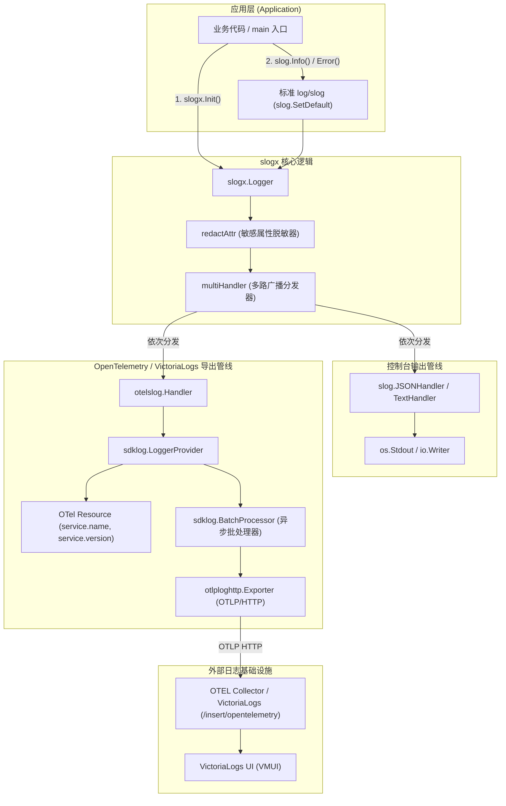
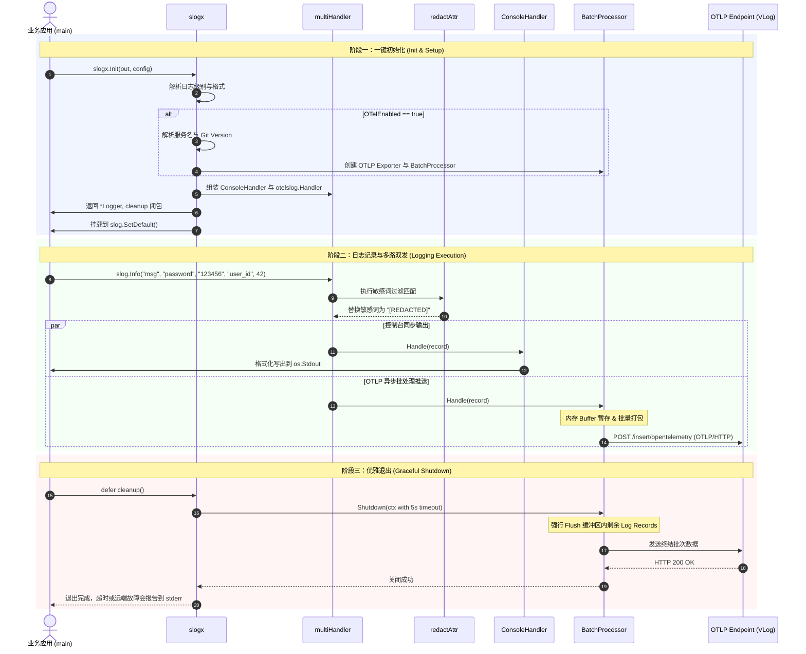

# slogx — 可移植 Go 高性能日志公共包

开箱即用的高性能 Go 日志组件包。基于 Go 标准库 `log/slog` 构建，集成 **OpenTelemetry Logs Bridge**、**VictoriaLogs / OTLP 同步导出**、**敏感信息自动脱敏**、**MultiHandler 多路输出** 与 **动态 Git Tag 版本推断**。

---

## 🌟 核心特性

- **零业务解耦**：无任何内部代码依赖，只需直接复制 本包即可移植到任意独立 Go 项目。
- **VictoriaLogs & OTEL 原生集成**：内置支持 OTLP HTTP 日志批处理异步导出（支持 VictoriaLogs `/insert/opentelemetry` 及标准 OpenTelemetry Collector）。
- **分布式链路追踪关联**：使用 `slog.InfoContext(ctx, ...)` 自动提取上下文中的 OpenTelemetry `trace_id` 与 `span_id`。
- **Error 日志代码诊断**：当为错误日志时，自动生成短路径 `caller`（如 `handlers/article.go:123`）及清洗后的完整 `stacktrace` 堆栈链。
- **高性能 Pool 缓存**：堆栈格式化采用 `sync.Pool` 对象池减少高并发下 GC 开销。
- **多路日志并发转发（MultiHandler）**：支持控制台（Stdout）与 远程 VLog 日志同时并行双发。
- **敏感信息自动脱敏**：普通属性、分组属性及 `Logger.With` 预绑定属性都会在控制台和 OTLP 输出前递归脱敏；内置敏感字段包括 `password`、`token`、`secret`、`authorization`、`api_key` 等。
- **数据库安全元数据**：Redis 错误不记录命令参数，GORM 慢查询和错误不记录插值 SQL，只保留命令/语句类型、耗时、数量等诊断元数据。
- **环境与版本推断**：自动注入 `env` 部署环境属性及 Git Tag / Commit 版本推断。

---

## 🏗️ 架构设计图

系统整体采用模块化与无锁多路广播设计，核心组件关系如下：



---

## 🔄 交互时序图

组件初始化、日志异步处理与优雅退出的完整生命周期交互流程如下：



---

## 📦 安装

```bash
go get github.com/kart-io/slogx
```

本地开发未发布时，可在项目 `go.mod` 中使用 replace 指向工作区路径：
```
replace github.com/kart-io/slogx => ../../slogx
```

### 备选：拷贝代码目录
无法使用 go get 时，也可直接复制本目录到您的项目中。

### 2. 引入依赖
在您的项目 `go.mod` 中添加依赖：
```bash
go get log/slog
go get go.opentelemetry.io/contrib/bridges/otelslog
go get go.opentelemetry.io/otel/exporters/otlp/otlplog/otlploghttp
go get go.opentelemetry.io/otel/sdk/log
```

---

## 🚀 使用示例

### 1. 一键初始化与挂载全局日志（推荐）

在项目的 `main.go` 入口中：

```go
package main

import (
	"log/slog"
	"os"

	"github.com/kart-io/slogx"
)

func main() {
	// 初始化日志，并开启 VictoriaLogs 日志实时同步
	_, cleanup, err := slogx.Init(os.Stdout, slogx.Config{
		Service:      "my-service-name", // 服务名称
		Level:        "info",            // debug | info | warn | error
		Format:       "json",            // json | text
		AddSource:    true,              // 是否显示调用源码行号
		OTelEnabled:  true,              // 开启 OTEL / VictoriaLogs 同步
		OTelEndpoint: "localhost:4318",   // OTEL Collector 或 VictoriaLogs 端口
		OTelInsecure: true,              // 禁用 TLS 证书校验
	})
	if err != nil {
		panic(err)
	}
	defer cleanup() // 尝试在 5 秒内 Flush；失败会报告到 stderr

	// 直接使用标准 slog 记录日志即可自动发布到控制台与 VLog！
	slog.Info("Service started successfully", "port", 8080)
	slog.Warn("Database query warning", "duration_ms", 120)
	slog.Error("Failed to fetch user", "user_id", 42, "access_token", "top-secret")
}
```

---

## 🔌 常用组件适配接入 (GORM & Redis)

### 1. GORM 数据库慢查询与安全元数据接入

```go
import "gorm.io/gorm"
import "github.com/kart-io/slogx"

db, err := gorm.Open(dialector, &gorm.Config{
    // 将普通查询、查询错误和慢查询（> 200ms）转换为 slog。
    // sql 字段包含插值后的完整查询与参数值；请按敏感数据要求控制日志权限和保留期。
    Logger: slogx.NewGORMLogger(200 * time.Millisecond),
})
```

### 2. Redis 缓存 Hook 监控接入

```go
import "github.com/redis/go-redis/v9"
import "github.com/kart-io/slogx"

client := redis.NewClient(&redis.Options{Addr: "localhost:6379"})
// 自动拦截拨号失败与指令异常并写入 slog / VictoriaLogs
client.AddHook(slogx.NewRedisHook())
```

| 配置项 | 类型 | 默认值 | 说明 |
| :--- | :--- | :--- | :--- |
| `Service` | `string` | `"app"` | 服务标识，记录在日志的 `service.name` 及 `service` 字段 |
| `Version` | `string` | 动态识别 | 服务版本号，留空时自动抓取 Git Tag 或 Commit Hash |
| `Env` | `string` | 动态推断 | 运行环境（如 `dev`, `test`, `prod`），留空自动推断 `WECHAT_LOGGING_ENV`/`APP_ENV`/`WECHAT_SERVER_MODE` |
| `Level` | `string` | `"info"` | 日志级别（`debug`, `info`, `warn`, `error`） |
| `Format` | `string` | `"json"` | 控制台输出格式（`json`, `text`） |
| `AddSource` | `bool` | `false` | 是否包含日志代码源文件名与行号 |
| `OTelEnabled` | `bool` | `false` | 是否开启 OpenTelemetry / VictoriaLogs 日志导出 |
| `OTelEndpoint` | `string` | `"localhost:4318"` | 接收端地址 (无需写 `http://`) |
| `OTelInsecure` | `bool` | `true` | 是否使用非 TLS HTTP 传输 |

---

## 🛠️ VictoriaLogs 搭配部署 (Docker)

如需测试 VictoriaLogs 展示，可通过如下配置快速拉起：

```yaml
services:
  victoria-logs:
    image: victoriametrics/victoria-logs:latest
    container_name: victoria-logs
    ports:
      - "9428:9428" # VictoriaLogs UI (http://localhost:9428/select/vmui/)

  vlog-collector:
    image: otel/opentelemetry-collector-contrib:0.118.0
    container_name: vlog-collector
    ports:
      - "4318:4318" # OTLP HTTP Ingestion Entrance
```
